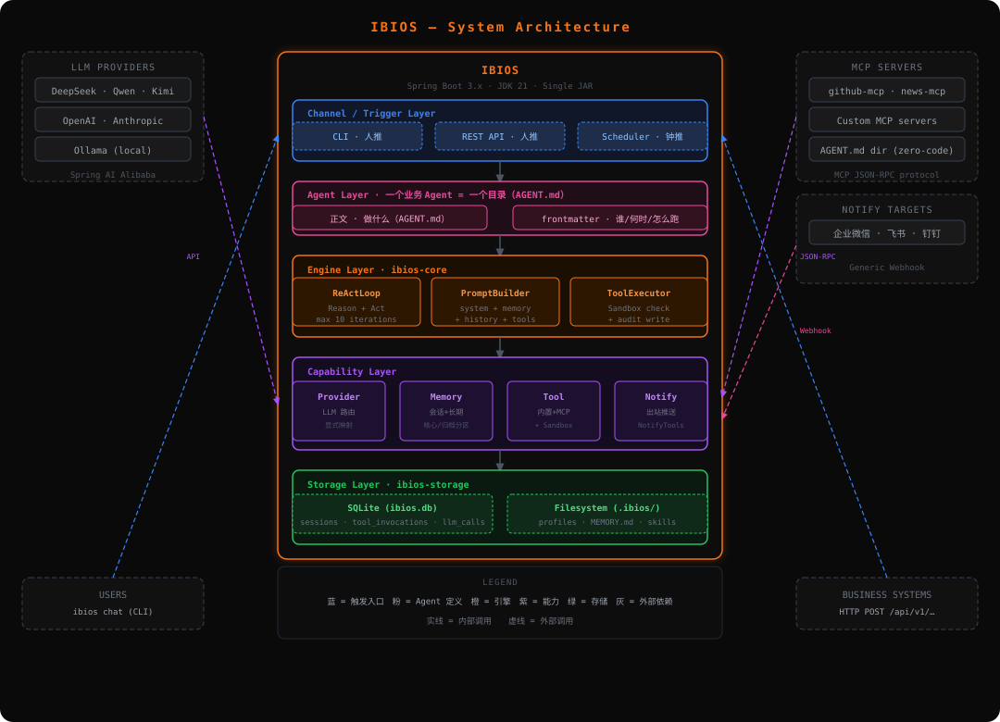

<p align="center">
  
</p>
<p align="center">
  <strong>企业级 Agent OS — 运行和管理 AI Agent 的统一底座</strong>
</p>
<p align="center">
  
  
  
  
</p>

---

IBIOS 是一个 **Java 原生的企业级 Agent OS**，为企业提供一个私有部署、完全可审计的 AI Agent 统一运行底座。它装在用户自己的机器上，向上为各类业务 Agent（运维助手、客服助手、HR 助手等）提供统一运行环境，向下接入 LLM、工具、记忆、渠道和审计基础设施。

**核心价值：私有部署、完全可审计、Java 原生、数据不出企业。**

---

## 为什么需要 IBIOS

单个 Agent 容易做出 demo，但一旦要在企业生产环境跑起来，就会撞上集成、数据安全、审计合规、多租户隔离等工程问题。IBIOS 解决的就是这些问题：

- **统一底座** — 多个 Agent 共享一套渠道接入、模型路由、记忆系统、工具调用、安全审计能力
- **私有可控** — 数据完全留在企业自己的基础设施，不锁任何云生态
- **Java 原生** — 基于 Spring Boot，运维体系无缝对接企业现有 Java 基础设施
- **完全可审计** — 谁、在什么时候、让哪个 Agent、调了什么工具、访问了什么数据，全程结构化留痕

## 核心特性

| 能力 | 说明 |
|------|------|
| **LLM Provider 抽象** | 通过 Spring AI Alibaba 对接十余个主流 LLM（通义、文心、DeepSeek、Kimi 等），Agent 不感知具体调的是哪家 |
| **自实现 ReAct 循环** | Agent 核心引擎完全可控，不依赖 Spring AI 的 Agent 抽象，保留定制循环行为的空间 |
| **三层记忆** | 会话记忆 + 长期记忆（MEMORY.md），支持 Markdown / SQLite / Mem0 三档后端 |
| **Plugin Tool 三档接入** | 零代码 AGENT.md + MCP（主推）、轻代码自写 MCP server、重代码 Java @Tool |
| **Web Service** | REST API 对外暴露所有能力，业务系统通过 HTTP 集成 |
| **Sandbox 安全隔离** | 接口先行设计，核心阶段白名单校验，扩展阶段可升级至容器/microVM |

## 快速开始

### 前置条件

- JDK 21+
- Maven 3.9+
- LLM API Key（如 DashScope）

### 构建

```bash
git clone https://github.com/FengMin-I/IBIOS.git
cd IBIOS
mvn clean verify
```

### 配置 LLM Provider

```bash
export DASHSCOPE_API_KEY=your-api-key
```

### 运行

```bash
java -jar ibios-boot/target/ibios-boot.jar
```

## 架构



### 模块结构

```
ibios/
├── ibios-core          # 核心抽象：Profile、IbiosTool、ReActLoop、Sandbox
├── ibios-provider      # LLM Provider 抽象、多 Provider 路由、ToolSchema 翻译
├── ibios-storage       # 持久化：Session、LlmCall、ToolInvocation
├── ibios-memory        # MemoryService 三层门面、LongTermMemory
├── ibios-tool          # 内置 Tool、MCP Client、ToolRegistry
├── ibios-web           # REST API、Web Server
├── ibios-cli           # Picocli 命令行工具
├── ibios-channel-cli   # CLI Channel 接入
└── ibios-boot          # Spring Boot 启动模块
```

### Agent 定义

一个 Agent = 一个目录 `.ibios/agents/<name>/`：

```
.ibios/agents/my-agent/
├── AGENT.md            # frontmatter（运行配置）+ 任务说明正文
├── skills/             # 可选：绑定 Skill
├── scripts/            # 可选：Python 脚本
└── REFERENCE.md        # 可选：参考文档
```

## 技术栈

| 组件 | 选择 |
|------|------|
| 运行时 | JDK 21 + Spring Boot 3.x |
| LLM 调用 | Spring AI + Spring AI Alibaba |
| Agent 循环 | 自实现 ReAct loop |
| HTTP 服务 | Spring MVC + Virtual Threads |
| 持久化 | SQLite + Spring Data JPA |
| 数据库迁移 | Flyway |
| CLI | Picocli |
| 日志 | Logback + SLF4J |
| 监控 | Micrometer + Prometheus |

## 项目路线图

| 阶段 | 内容 | 状态 |
|------|------|------|
| **核心阶段** | 五大核心能力（Provider、ReAct、Memory、Tool、Web Service），9 个 Maven 模块 | 进行中 |
| **扩展阶段** | 企业级治理（多租户、SSO、RBAC、完整审计、Tool Policy）、Sandbox 升级至容器/microVM | 规划中 |
| **社区阶段** | 社区共建 Skill 库、Plugin Tool 市场、最佳实践 | 规划中 |

核心阶段按 5 个 User Story 推进：

```
US-1 (Provider) → US-2 (ReAct) → US-3 (Memory) ∥ US-4 (Tool) → US-5 (Web Service)
```

## 文档

| 文档 | 说明 |
|------|------|
| [业界调研](docs/IndustryResearch.md) | Agent OS 行业格局、Java 生态缺位、IBIOS 定位 |
| [需求文档](docs/DemandAnalysis.md) | 五大核心能力、功能清单、验收标准 |
| [技术方案](docs/TechnicalSolution.md) | 架构设计、关键决策、模块职责 |
| [编程指南](docs/AiProgrammingGuide.md) | Spec-Kit 开发流程、User Story 拆解 |
| [项目宪章](.specify/memory/constitution.md) | 10 条非协商原则 |

## 开发

```bash
# 编译 + 跑单测
mvn clean verify

# 格式化代码
mvn spotless:apply

# 跑集成测试
DASHSCOPE_API_KEY=xxx mvn verify -Dgroups=integration
```

## 贡献

本项目是教学项目，当前按课件节奏逐节推进。欢迎通过 Issue 讨论和提问。

## 许可证

[Apache License 2.0](LICENSE)
