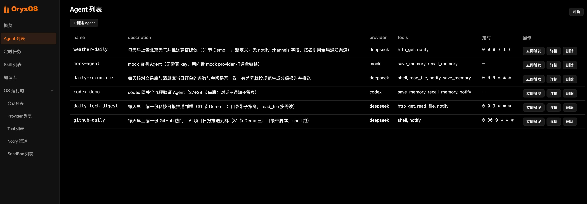

<p align="center">
  
</p>
<p align="center">
  <strong>企业级 Agent Harness OS — 把模型变成 Agent，把 Agent 跑成一支队伍</strong>
</p>
<p align="center">
  
  
  
  
</p>

---

IBIOS 是一个 **Java 原生的企业级 Agent Harness OS**：给每个 Agent 同一套生产级 harness，再像操作系统调度进程一样运行一整队 Agent。它装在用户自己的机器上，向上为各类业务 Agent（运维助手、客服助手、HR 助手等）提供统一运行环境，向下接入 LLM、工具、记忆、渠道和审计基础设施。

**核心价值：私有部署、完全可审计、Java 原生、数据不出企业。**

---

## 三层：Model → Harness → OS

生产环境里，决定一个 Agent 能不能干活的，通常不是模型，而是模型外面那层 harness。IBIOS 把这个判断做成了三层结构：

| | 裸模型 | Agent Harness | Agent Harness OS |
|---|---|---|---|
| 范围 | 单次 LLM 调用 | 单个可靠的 Agent | 一整队 Agent |
| 提供什么 | 文本生成 | 循环、工具 + 执行、上下文、记忆、沙箱、审计、投递 | 生命周期、渠道接入、路由、共享注册表、调度、治理、管理台 + API |
| 入口 | 一次模型 API 调用 | 一次库调用或框架调用 | 带 REST API 的可部署二进制 / 可执行 JAR |
| 多 Agent | 不在范围内 | 不在范围内 | 一等公民：多 Agent、共享能力、运行时生命周期管理 |
| 类比 | 一条 CPU 指令 | 一个带运行时的进程 | 运行一群进程的操作系统 |

模型生成文本。Harness 把一个模型变成一个真正能干活的 Agent。Harness **OS** 把同一套 harness 交给每个 Agent、运行整支队伍——也只有在这一层，「Agent 团队」才成为可能。

## 什么是 agent harness

**Agent harness（运行骨架）** 是套在模型外面、把模型变成能干活的 Agent 的那层脚手架：

- **循环** — 驱动 reason → act → observe，决定何时继续、何时收束
- **工具与执行** — Agent 能调什么、由谁执行、执行前后的校验
- **上下文** — 每次 LLM 调用前组装好的系统提示词、记忆、历史与工具清单
- **记忆** — 跨对话保留的状态，按 Agent 隔离
- **沙箱** — 约束文件、命令、网络访问的白名单
- **审计** — 记录谁在什么时候调了什么、传了什么、返回了什么、花了多久

裸模型只会生成文本——harness 才让它可靠、安全地「做事」。企业又从来不会只跑一个 Agent，所以 IBIOS 在 harness 之上再提供操作系统那一层。

## 为什么需要 IBIOS

单个 Agent 容易做出 demo，但一旦要在企业生产环境跑起来，就会撞上集成、数据安全、审计合规、多租户隔离等工程问题——这些都不是模型能力问题，而是 harness 与运行环境问题：

- **统一底座** — 多个 Agent 共享一套 harness：渠道接入、模型路由、记忆系统、工具调用、安全审计
- **私有可控** — 数据完全留在企业自己的基础设施，不锁任何云生态
- **Java 原生** — 基于 Spring Boot，运维体系无缝对接企业现有 Java 基础设施
- **完全可审计** — 谁、在什么时候、让哪个 Agent、调了什么工具、访问了什么数据，全程结构化留痕

## 核心能力

### Harness 层：把一个模型变成 Agent

| 能力 | 说明 |
|------|------|
| **自实现 ReAct 循环** | 完整掌控 reason → act → observe，不依赖 Spring AI 的 Agent 抽象，循环行为完全可控 |
| **LLM Provider 抽象** | 通过 Spring AI Alibaba 对接主流 LLM（通义、DeepSeek、Kimi 等），显式 name → ChatModel 映射，Agent 不感知具体厂商 |
| **三层记忆** | 会话记忆 + 长期记忆（每个 Agent 一份 MEMORY.md），支持 Markdown / SQLite / Mem0 三档后端 |
| **Plugin Tool 三档接入** | 零代码 AGENT.md + MCP（主推）、轻代码自写 MCP server、重代码 Java @Tool |
| **Sandbox 安全隔离** | 文件 / Shell / HTTP 白名单校验，接口先行，扩展阶段可升级至容器 / microVM |
| **全链路审计** | 工具调用与 LLM 调用从第一天起写库，成功失败都留痕 |

### OS 层：把一群 Agent 跑起来

| 能力 | 说明 |
|------|------|
| **一个目录 = 一个 Agent** | `.ibios/agents/<name>/` 放进去就上线，WorkspaceWatcher 热加载，免重启、零代码 |
| **Agent 生命周期** | REST / 管理台运行时创建、编辑、删除、归档，支持一句话生成 AGENT.md |
| **共享注册表** | 全局 ToolRegistry、Provider 注册表、Notify 渠道注册表，所有 Agent 共享同一套能力 |
| **调度与投递** | cron 定时触发、CLI / Web / Scheduler 三个入口汇入同一引擎，Notify 按渠道名推送 |
| **Web Service 与 API** | REST API 对外暴露全部能力，随包附带 Web 管理台 |

## 快速开始

### 前置条件

- JDK 21+
- Maven 3.9+
- Node.js 18+（仅开发管理台前端时需要）
- LLM API Key（如 DashScope）

### 编译

```bash
git clone https://github.com/FengMin-I/IBIOS.git
cd IBIOS
mvn clean install -DskipTests
```

### 配置 LLM Provider

编辑 `ibios.yaml`（或复制 `ibios.yaml.example`）：

```yaml
ibios:
  providers:
    - name: dashscope
      api-key: ${DASHSCOPE_API_KEY}
      model: qwen-plus
```

设置环境变量：

```bash
export DASHSCOPE_API_KEY=your-api-key
```

### 一键启动

使用提供的脚本启动 Server 和管理台：

```bash
# 启动服务（默认使用 ibios.yaml 配置）
./bin/start.sh

# 使用指定配置文件
./bin/start.sh ibios.yaml

# 停止服务
./bin/stop.sh
```

启动后访问：
- **管理台**：http://localhost:8080/admin
- **API 文档**：http://localhost:8080/swagger-ui.html
- **健康检查**：http://localhost:8080/api/v1/health

### 管理台开发模式

如果需要开发管理台前端，可以使用 Vite 开发服务器：

```bash
cd ibios-web/src/main/frontend
npm install
npm run dev
```

开发服务器启动在 http://localhost:5173，API 请求会自动代理到后端 http://localhost:8080。

修改前端代码后，页面会自动热更新。开发完成后执行 `npm run build` 构建生产版本，产物输出到 `ibios-web/src/main/resources/static/admin/`。

## 管理台预览



管理台提供以下功能页面：
- **概览** — 系统状态、核心能力展示
- **Agent** — 已配置的 Agent 列表与详情（文件浏览器）
- **Provider** — LLM Provider 连接状态与 CRUD
- **Tool** — 已注册的工具列表
- **Sandbox 白名单** — 文件 / Shell / HTTP 访问控制规则
- **Notify 渠道** — 通知渠道注册表
- **定时任务** — cron 任务与执行历史
- **会话** — 历史会话记录
- **运行状态** — 系统健康状态和版本信息

## 架构


### 模块结构

```
ibios/
├── ibios-core          # 核心抽象：Profile、IbiosTool、ReActLoop、PromptBuilder、Sandbox
├── ibios-provider      # LLM Provider 抽象、多 Provider 路由、ToolSchema 翻译
├── ibios-storage       # 持久化：Session、LlmCall、ToolInvocation、Provider、Notify
├── ibios-memory        # MemoryService 三层门面、LongTermMemory、MemoryTools
├── ibios-tool          # 内置 Tool、MCP Client、ToolRegistry、Sandbox 实现
├── ibios-web           # REST API、Web Server、管理台前端
├── ibios-cli           # Picocli 命令行工具
├── ibios-channel-cli   # CLI Channel 接入
└── ibios-boot          # Spring Boot 启动模块，打出可执行 JAR
```

### Agent 定义

一个 Agent = 一个目录 `.ibios/agents/<name>/`：

```
.ibios/agents/my-agent/
├── AGENT.md            # frontmatter（运行配置）+ 任务说明正文
├── skills/             # 可选：绑定 Skill
├── scripts/            # 可选：Python 脚本
└── REFERENCE.md        # 可选：参考文档
```

## 技术栈

| 组件 | 选择 |
|------|------|
| 运行时 | JDK 21 + Spring Boot 3.x |
| LLM 调用 | Spring AI + Spring AI Alibaba |
| Agent 循环 | 自实现 ReAct loop |
| HTTP 服务 | Spring MVC + Virtual Threads |
| 持久化 | SQLite + Spring Data JPA |
| 数据库迁移 | Flyway |
| CLI | Picocli |
| 日志 | Logback + SLF4J |
| 监控 | Micrometer + Prometheus |
| 管理台前端 | Vue 3 + Vite |

## 项目路线图

| 阶段 | 内容 | 状态 |
|------|------|------|
| **核心阶段** | 五大核心能力（Provider、ReAct、Memory、Tool、Web Service），9 个 Maven 模块 | 进行中 |
| **扩展阶段** | 企业级治理（多租户、SSO、RBAC、完整审计、Tool Policy）、Sandbox 升级至容器 / microVM | 规划中 |
| **社区阶段** | 社区共建 Skill 库、Plugin Tool 市场、最佳实践 | 规划中 |

核心阶段按 5 个 User Story 推进：

```
US-1 (Provider) → US-2 (ReAct) → US-3 (Memory) ∥ US-4 (Tool) → US-5 (Web Service)
```

## 文档

| 文档 | 说明 |
|------|------|
| [IBIOS 是什么](docs/ibios.md) | Agent Harness OS 定义、北极星与设计原则 |
| [业界调研](docs/IndustryResearch.md) | Agent Harness OS 行业格局、Java 生态缺位、IBIOS 定位 |
| [需求文档](docs/DemandAnalysis.md) | 五大核心能力、功能清单、验收标准 |
| [技术方案](docs/TechnicalSolution.md) | 架构设计、关键决策、模块职责 |
| [编程指南](docs/AiProgrammingGuide.md) | Spec-Kit 开发流程、User Story 拆解 |
| [项目宪章](.specify/memory/constitution.md) | 10 条非协商原则 |

## 开发

```bash
# 编译 + 跑单测
mvn clean verify

# 格式化代码
mvn spotless:apply

# 跑集成测试
DASHSCOPE_API_KEY=xxx mvn verify -Dgroups=integration

# 管理台前端开发
cd ibios-web/src/main/frontend
npm run dev
```

## 贡献

本项目是教学项目，当前按课件节奏逐节推进。欢迎通过 Issue 讨论和提问。

## 许可证

[Apache License 2.0](LICENSE)
